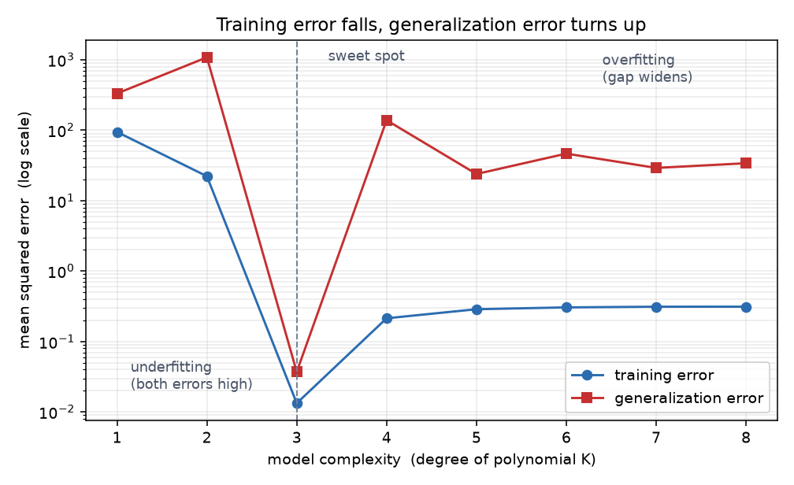

# B09 模型选择、欠拟合和过拟合

前八个单元都在做同一件事：把训练误差降下来。这一章问一个问题——
**训练误差低就说明模型好吗？** 答案是不一定，而且有办法判断什么时候不是。

## 与书对应

| 讲义小节 | 纸质书（第一版） | 电子版（第二版） |
|---|---|---|
| 1 训练误差与泛化误差 | 3.11 的"训练误差和泛化误差" | [4.4](https://zh.d2l.ai/chapter_multilayer-perceptrons/underfit-overfit.html) 的"训练误差和泛化误差" |
| 2 模型选择 | 3.11 的"模型选择"（验证数据集、k 折交叉验证） | 4.4 的"模型选择" |
| 3 欠拟合与过拟合 | 3.11 的"欠拟合和过拟合"（模型复杂度、训练数据集大小） | 4.4 的"模型复杂度"、"数据集大小" |
| 4 多项式拟合实验 | 3.11 的"多项式函数拟合实验" | 4.4 的实验 |
| 5 动手 | 3.11 的实验代码 | 4.4 的实验代码 |
| 6 实现会踩的坑 | 散在正文里，本节汇总 | 同上 |
| 自测题 | 无 | 无 |

**解锁点**：纸质书 3.11 里标"本函数已保存在 d2lzh 包中方便以后使用"的有
`semilogy`（画对数纵轴）与 `fit_and_plot`（训练并画两条误差曲线）。
这两个在讲义 4.2 与 5 节讲清楚做什么，B09 的题目要求自己写。

**这一章没有新模型**。参数更新还是 B06 那套，损失还是平方损失。
新东西只有两件：怎么切数据、怎么看结果。

## 0 这一单元解决什么问题

B06 到 B08 的训练流程有一个隐含假设：训练误差降下来就说明模型变好了。
这一章要讲清楚这个假设什么时候不成立，以及不成立时怎么发现。

三件事：

1. **训练误差与泛化误差为什么要分开看**
2. **怎么准备一份可以反复用的数据来选模型**
3. **看到两条误差曲线时，怎么判断是欠拟合还是过拟合**

这一章也是 B10 的前置：知道过拟合是什么之后，才好讲怎么对付它。

## 1 训练误差与泛化误差

**训练误差**（training error）是模型在训练数据集上的误差。
**泛化误差**（generalization error）是模型在任意一个测试样本上的误差的**期望**，
实践中用测试集上的误差近似。

### 1.1 为什么两者会有差距

书上的类比是高考：训练误差相当于做往年真题的错误率，泛化误差相当于真正高考的错误率。
两者都随机采自同一个考纲下的巨大题库。

关键在两句话：

**如果参数是随机设的**（相当于没学过中学知识的小学生），那么真题和高考题的得分率
**差不多**。因为在独立同分布假设下，任何一个固定模型（参数已定）在两个数据集上的
误差期望是相同的。

**但参数是从训练集学出来的**。学习的依据是最小化训练误差，所以参数"见过"训练集。
这让训练误差的期望**小于或等于**泛化误差。

$$\text{训练误差} \le \text{泛化误差} \quad (\text{期望意义下})$$

### 1.2 结论

**无法从训练误差估计泛化误差。** 一味降低训练误差，泛化误差不一定跟着降。

这句话是这一章的出发点。B06 到 B08 报的都是训练损失与测试精度，从这一章起要养成
**同时看两个**的习惯。

## 2 模型选择

从若干候选模型里挑一个，这个过程叫**模型选择**（model selection）。候选可以是不同超参数
的同类模型，例如 MLP 的隐藏层数、隐藏单元数、激活函数。

### 2.1 验证集

**测试集只能在所有超参数与模型参数都选定之后使用一次。** 用它来调参，
调出来的结果就不再是对未见数据的估计了——你已经在测试集上做了选择。

所以要另留一份数据：**验证集**（validation set）。常见做法是从训练集里随机切一小部分出来。

**书上的坦白**：实际工作中数据不容易获取，测试集极少只用一次就丢弃，
所以验证集与测试集的界限在实践中比较模糊。书里后续实验报的"测试精度"严格说是验证精度。
这一点要知道，但不必因此改代码。

### 2.2 k 折交叉验证

预留验证集的问题是"浪费数据"：训练数据本来就不多时，切掉一块更不够用。

**k 折交叉验证**（k-fold cross-validation）把它摊开：把训练集分成 $k$ 个不重合的子集，
做 $k$ 次训练与验证。每次用一个子集当验证集、其余 $k-1$ 个当训练集，
最后对 $k$ 次的训练误差与验证误差分别求平均。

**代价是训练时间乘以 k。** 深度学习里模型大、训练慢，所以常用 $k=3$ 或 $5$，
而不是教科书里常见的 $10$。什么时候值得用：数据少、模型小、要比较的候选多。

**两版都讲了这一节，书上没有给代码。** 这一章的题目里会要求自己实现切分。

## 3 欠拟合与过拟合

两类典型问题：

| 名字 | 现象 |
|---|---|
| **欠拟合**（underfitting）| 模型**连训练误差都降不下来** |
| **过拟合**（overfitting）| 训练误差远小于测试误差 |

**判断依据是两条曲线的相对位置，不是某一个误差的绝对值。** 训练误差 0.5 说明不了什么，
"训练 0.01、测试 0.5"才说明过拟合。

两个主要因素：

### 3.1 模型复杂度

用多项式拟合说明。要找的是 $K$ 阶多项式

$$\hat y = b + \sum_{k=1}^{K} x^k w_k .$$

$K$ 越大，参数越多，函数的选择空间越大，**复杂度越高**。复杂度高意味着更容易在同一个
训练集上得到更低的训练误差，也更容易把训练集里的噪声一起学进去。

一阶多项式就是线性函数拟合。



图里三条信息：**训练误差随复杂度单调下降**；**泛化误差先降后升**；
**在泛化误差最低点左侧是欠拟合，右侧是过拟合**。

所以应对这两个问题的一个办法是：针对数据集选合适复杂度的模型。

### 3.2 训练数据集大小

样本数太少时过拟合更容易发生，**特别是样本数比模型参数个数还少的时候**。
反过来，泛化误差不会因为样本变多而变大，所以在算力允许时训练集越大越好，
模型越复杂越是如此。

## 4 多项式拟合实验

书上用一个人工数据集把三种情况摆出来。

### 4.1 生成数据

$$y = 1.2x - 3.4x^2 + 5.6x^3 + 5 + \epsilon,\qquad \epsilon \sim \mathcal{N}(0, 0.1^2) .$$

- 特征 $x$ 取标准正态随机数，训练集与测试集**各 100 个样本**
- 真实参数是 $w_1=1.2$、$w_2=-3.4$、$w_3=5.6$、$b=5$

**注意特征怎么造**：模型要用 $x$、$x^2$、$x^3$ 三列，所以原始的一列特征要扩成三列
（书上叫 `poly_features`）。这是"特征工程"最简单的例子——不改模型，
只把输入换成它的幂，就能让线性模型拟合三次函数。

### 4.2 三个实验

| 实验 | 用什么拟合 | 预期现象 |
|---|---|---|
| 正常 | 同阶的三阶多项式 | 训练误差与测试误差都低，学到的参数接近真实值 |
| 欠拟合 | 线性函数（一阶） | **训练误差降到一定程度就降不下去**，测试误差同样高 |
| 过拟合 | 三阶多项式，但**只用 2 个样本训练** | 训练误差很低，**测试误差很高** |

第三个实验是本单元的重点：模型与数据生成函数同阶（本该是"对的模型"），
只因为样本太少（2 个样本，比参数个数还少）就过拟合了。
**这说明过拟合不只取决于模型，也取决于数据量。**

### 4.3 怎么看结果

书上画的图纵轴用**对数刻度**，函数名就叫 `semilogy`。原因是两个误差常常相差一两个数量级，
线性刻度下小的那条贴在轴上看不出来。

**两条曲线画在一张图上**要多两个东西：每条的标签与图例。A0 的 4.7 节只讲了单条折线，
这里是第一次画多条：

```python
plt.figure(figsize=(7, 4))
plt.semilogy(epochs, train_loss, label="training error")
plt.semilogy(epochs, test_loss, label="generalization error")
plt.xlabel("epoch")
plt.ylabel("mean squared error (log scale)")
plt.legend()                      # 把上面 label= 的文字画成图例
plt.savefig("curve.png", dpi=120)
```

四个要点：

- **横轴要显式给。** `plot(x, y)` 的两个参数分别是横坐标与纵坐标。只传一个参数时横轴取
  0, 1, 2, …，在这里恰好等于轮数减一，容易和"轮数从 1 开始"混淆
- **`label=` 是给图例用的文字**，写在每次 `plot` 调用里
- **`plt.legend()` 负责把那些文字画出来。** 不调它，`label=` 写了也不显示
- **`plt.semilogy` 与 `plt.plot` 用法相同**，区别只在纵轴取对数

**保存与显示的区别**：`plt.savefig(path)` 把当前画布写到文件；`plt.show()` 只在有图形界面时
弹窗，脚本跑完什么也不留下。脚本里用 `savefig`，并且要在 `show` 之前调用，
否则某些后端会存出一张空白图。

**图存到哪由调用方决定。** 写函数时把路径当参数收，不要在函数里写死文件名——
这样同一份代码既能被验收脚本用，也能被你手动调用存到 `work/` 下慢慢看。

### 4.4 对数坐标下的曲线为什么是直线

第一次画出这张图会有一个疑问：曲线怎么这么直，是不是画错了。

**没有错。** 损失在训练后期按指数衰减，写成 $L_t \approx L_0 e^{-\lambda t}$，
两边取对数得到 $\log L_t \approx \log L_0 - \lambda t$——关于轮数 $t$ 的一次函数。
所以**在对数纵轴上，指数衰减就是一条直线**。前几轮偏离直线，是因为那时 bias 还在调，
还没进入稳定的指数衰减区间。

反过来说，**直线本身是一个有用的信号**：它说明学习率合适、训练稳定。
若曲线在对数坐标下向上翘或者抖动剧烈，那才是出了问题。

### 4.5 从图上读三件事

画完图先看这三条，比看具体数值快：

| 看到什么 | 说明 |
|---|---|
| 两条曲线都往下，且靠得近 | 正常，还可以继续训 |
| 两条都高、都降不下去 | 欠拟合，模型太简单或特征没造对 |
| 训练往下、测试在某轮开始往上翘，两条分开 | 过拟合，该加数据或加正则化 |

**测试损失略低于训练损失是正常的**，不是错误。测试集是另一批随机样本，
这一批恰好容易一点，反过来也常见。要关注的是两者的**差距是否在拉大**。

## 5 动手

这一章要自己写的四件东西：

| 要做的事 | 要点 |
|---|---|
| 生成数据 | 按 4.1 的公式；训练集与测试集各 100 个；噪声标准差 0.1；用随机种子保证可复现 |
| 造特征矩阵 | 把一列 $x$ 扩成 $[x, x^2, x^3]$ 三列。阶数 $K$ 是参数 |
| 训练并记录 | 每轮记下训练误差与测试误差。参数更新沿用 B06：小批量、平方损失、`sgd` |
| 画图 | 横轴轮数、纵轴误差、对数刻度、两条曲线 |

**平方损失与评估要区分**：训练时用 B06 那份返回**和**的 `squared_loss`，
记录时要换成**平均**损失（除以样本数），否则三条曲线的量级没法直接比。

模型参数用 `nn.Sequential` 或裸张量都行——$K$ 阶多项式就是一个线性层，
不需要隐藏层。

## 6 实现会踩的坑

| 坑 | 症状 | 原因 |
|---|---|---|
| 忘了把特征升幂 | 三阶模型和线性模型一样差 | 输入只有一列，线性层学不出 $x^2$ 的贡献（4.1）|
| 训练集与测试集用了不同的随机数生成器 | 两者分布不同，曲线没意义 | 造数据时只用一个 `Generator`（B05 的 9.2）|
| 训练误差记的是"和" | 与测试误差差 100 倍 | 记录的必须是平均损失（5）|
| 用测试集选超参数 | 报出来的精度偏乐观 | 该用验证集（2.1）|
| 只看最终值不看曲线 | 判断不出是欠拟合还是过拟合 | 判断依据是两条曲线的**相对位置**（3）|
| 过拟合实验里仍用 100 个样本 | 看不到过拟合 | 那个实验的关键是**只用 2 个样本**（4.2）|
| 图上两条曲线重叠 | 分不清哪条是哪条 | 用对数纵轴，并加图例（4.3）|

## 命令速查

| 命令 | 作用 | 讲义哪一节 |
|---|---|---|
| `torch.randn(n, 1)` | 生成标准正态特征 | 4.1 |
| `x ** k` | 逐元素求幂，用来造多项式特征 | 4.1 |
| `torch.cat([...], dim=1)` | 把几列拼成特征矩阵 | 4.1 |
| `torch.manual_seed(seed)` | 固定随机种子 | 4.1 |
| `plt.semilogy(x, y)` | 纵轴取对数刻度的折线图 | 4.3 |
| `plt.legend()` | 显示图例 | 4.3 |
| `torch.utils.data.random_split` | 随机切分数据集 | 2.1 |
| `tensor.mean()` | 求平均，用来把损失之和换成平均损失 | 5 |

## 自测题

1. 训练误差与泛化误差分别是什么？为什么前者在期望意义下不大于后者？
2. 测试集为什么只能用一次？那验证集是用来做什么的？
3. k 折交叉验证怎么做？代价是什么？什么情况下值得用？
4. 怎么从两条误差曲线判断是欠拟合还是过拟合？
5. 过拟合实验里模型与数据生成函数同阶，为什么还会过拟合？
6. 训练误差 0.01、测试误差 0.5，这是哪种情况？反过来呢？
7. 为什么画误差曲线时纵轴要用对数刻度？

## 答案（做完再看）

**1.** 训练误差是模型在训练集上的误差；泛化误差是模型在任意未见样本上误差的期望，
用测试集近似。参数是从训练集学出来的，学习的依据就是最小化训练误差，
所以训练误差的期望不大于泛化误差。若参数是随机设的（没学过），两者会相近。

**2.** 用测试集调参之后，测试集就参与了模型选择，它上面的结果不再是对未见数据的估计。
验证集专门用来做模型选择与调参，这样测试集能保持"只用一次"。

**3.** 把训练集分成 $k$ 个不重合子集，做 $k$ 次训练与验证，每次换一个子集当验证集，
最后对 $k$ 次的训练误差与验证误差分别取平均。代价是训练时间变成 $k$ 倍。
数据少、模型小、候选多的时候值得用。

**4.** 看两条曲线的**相对位置**。训练误差降不下去（两条都高）是欠拟合；
训练误差很低而测试误差明显高出一截是过拟合。

**5.** 因为训练样本只有 2 个，比模型参数个数还少。过拟合不只取决于模型复杂度，
也取决于数据量——数据太少时，即使模型形式正确，它也会去拟合那两个样本里的噪声。

**6.** 训练 0.01、测试 0.5 是过拟合。反过来训练 0.5、测试 0.5（或更高一点）是欠拟合：
模型连训练集都没学好。

**7.** 两个误差常常相差一两个数量级。线性刻度下小的那条会贴在横轴上，看不出趋势。
对数刻度让两者都能看清。
