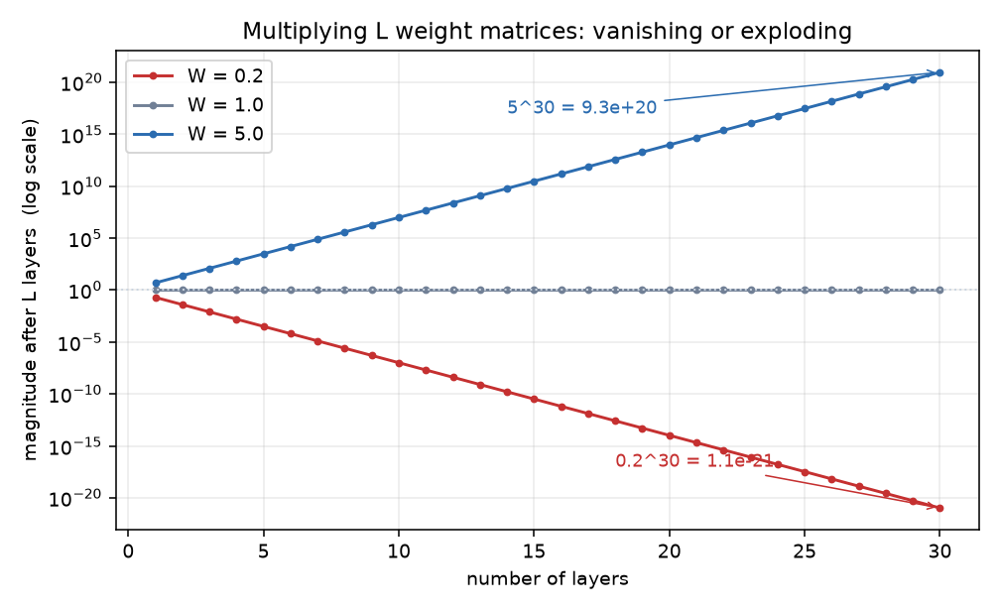

# B11 正向传播、反向传播与数值稳定性

B04 讲了"自动微分能算梯度"，用 `backward()` 一行就得到全部参数的梯度。
这一章把这个黑盒拆开：**它内部在算什么、按什么顺序算、为什么这么算**。
后半章换到另一个问题：层数一多，数值会衰减或爆炸。

## 与书对应

| 讲义小节 | 纸质书（第一版） | 电子版（第二版） |
|---|---|---|
| 1 正向传播 | 3.14 的"正向传播"、"正向传播的计算图" | [4.7](https://zh.d2l.ai/chapter_multilayer-perceptrons/backprop.html) 的对应小节 |
| 2 反向传播 | 3.14 的"反向传播" | 4.7 的"反向传播" |
| 3 训练与这套流程的关系 | 3.14 的"训练深度学习模型" | 4.7 的对应小节 |
| 4 数值稳定性 | 3.15 的"衰减和爆炸" | [4.8](https://zh.d2l.ai/chapter_multilayer-perceptrons/numerical-stability-and-init.html) 的对应小节 |
| 5 参数初始化 | 3.15 的"随机初始化模型参数"（MXNet 默认、Xavier） | 4.8 的对应小节 |
| 6 实现会踩的坑 | 散在正文里，本节汇总 | 同上 |
| 自测题 | 无 | 无 |

**解锁点**：纸质书这两节里没有"本函数已保存在 d2lzh 包中方便以后使用"的标注。
3.14 通篇是公式推导，3.15 的代码只有初始化方法。

**这一章与 B04 的关系**：B04 学的是"怎么用"自动微分，这一章学"它算了什么"。
两章合起来才算把梯度这件事弄清楚——会调 `backward()` 但不清楚它内部按什么顺序算，
遇到梯度对不上或算出 `nan` 时就没有排查的思路。

## 0 这一单元解决什么问题

B04 里写过这样的代码，一行拿到全部梯度：

```python
loss.backward()
```

这一章回答三个问题：

1. `backward()` 到底算了什么？为什么一行就够
2. 它按什么顺序算？为什么从后往前
3. 层数多了之后梯度为什么会消失或爆炸，初始化能做什么

第三问引出的 Xavier 初始化，是后面深网络（B13 以后）的基础。

## 1 正向传播

**正向传播**（forward propagation）是按从输入到输出的顺序，依次计算并存储中间变量。

书上用一个最简模型讲。输入是单个样本 $\mathbf{x}\in\mathbb{R}^d$，先不考虑偏置：

$$\begin{aligned}
\mathbf{z} &= \mathbf{W}^{(1)}\mathbf{x},\\
\mathbf{h} &= \phi(\mathbf{z}),\\
\mathbf{o} &= \mathbf{W}^{(2)}\mathbf{h},\\
L &= \ell(\mathbf{o}, y).
\end{aligned}$$

其中 $\mathbf{W}^{(1)}\in\mathbb{R}^{h\times d}$ 是隐藏层权重，$\mathbf{W}^{(2)}\in\mathbb{R}^{q\times h}$ 是输出层权重，
$\phi$ 是逐元素激活函数，$\ell$ 是损失函数。

再加 $L_2$ 正则项：

$$s = \frac{\lambda}{2}\left(\|\mathbf{W}^{(1)}\|_F^2 + \|\mathbf{W}^{(2)}\|_F^2\right),$$

最终的**目标函数**是

$$J = L + s .$$

**注意 $s$ 只依赖权重，不依赖数据**。所以它的梯度很直接：
$\partial s/\partial\mathbf{W}^{(1)} = \lambda\mathbf{W}^{(1)}$。

### 1.1 计算图

把每一步画成有向图：**方框是变量，圆圈是运算符，箭头表示依赖**。
输入在左，输出在右。

**为什么要有计算图**：因为它把"谁依赖谁"显式化了。反向传播需要的正是这张图的逆序——
从输出往回走，每个节点把上游传来的梯度乘上自己的局部导数，再传给下游。

B04 讲过 PyTorch 会为每个运算隐式建图；这一节是那张图的显式版本。

## 2 反向传播

**反向传播**（back-propagation）是计算梯度的方法，依据是链式法则：
**沿着从输出层到输入层的方向，依次计算并存储目标函数对各中间变量与参数的梯度**。

### 2.1 链式法则的形状问题

对 $\mathsf{Y}=f(\mathsf{X})$、$\mathsf{Z}=g(\mathsf{Y})$，链式法则是

$$\frac{\partial \mathsf{Z}}{\partial \mathsf{X}} = \operatorname{prod}\left(\frac{\partial \mathsf{Z}}{\partial \mathsf{Y}}, \frac{\partial \mathsf{Y}}{\partial \mathsf{X}}\right).$$

$\operatorname{prod}$ 不是普通的乘法：它会**根据两个梯度的形状**决定要不要转置、要不要调换位置。
矩阵求导的结果形状取决于约定，`prod` 就是把这个约定包装起来的符号。

**实践含义**：手写反向传播时最常见的错不是导数算错，而是**形状对不上**。
B04 里手推 `y = x @ w` 的梯度时就遇到过这个问题——`∂L/∂w` 的形状要与 `w` 相同。

### 2.2 一步步算

书上按"目标函数 → 损失 → 输出 → 隐藏 → 输入"的顺序算。记 $\partial J/\partial \cdot$ 为对应量的梯度：

**第一步**：$J = L + s$，所以两个分支的梯度都是 1：

$$\frac{\partial J}{\partial L}=1,\qquad\frac{\partial J}{\partial s}=1 .$$

**第二步**：输出层变量的梯度就是损失对它的梯度：

$$\frac{\partial J}{\partial \mathbf{o}} = \frac{\partial L}{\partial \mathbf{o}} .$$

**第三步**：输出层权重的梯度，数据项与正则项各有一条：

$$\frac{\partial J}{\partial \mathbf{W}^{(2)}} = \frac{\partial J}{\partial \mathbf{o}}\mathbf{h}^\top + \lambda\mathbf{W}^{(2)} .$$

**第四步**：往回传到隐藏层。这里出现**转置**：

$$\frac{\partial J}{\partial \mathbf{h}} = {\mathbf{W}^{(2)}}^\top\frac{\partial J}{\partial \mathbf{o}} .$$

**第五步**：过激活函数。$\phi$ 是逐元素运算，所以用**逐元素乘**：

$$\frac{\partial J}{\partial \mathbf{z}} = \frac{\partial J}{\partial \mathbf{h}} \odot \phi'(\mathbf{z}) .$$

**第六步**：输入层权重的梯度：

$$\frac{\partial J}{\partial \mathbf{W}^{(1)}} = \frac{\partial J}{\partial \mathbf{z}}\mathbf{x}^\top + \lambda\mathbf{W}^{(1)} .$$

### 2.3 两个反复出现的模式

看第三、四、五步，会发现三件事重复出现：

| 位置 | 运算 | 为什么 |
|---|---|---|
| 经过线性层（反向）| 乘权重的**转置** | 正向是 $\mathbf{W}\mathbf{x}$，反向要对 $\mathbf{x}$ 求导，得到 $\mathbf{W}^\top$ |
| 线性层权重的梯度 | 上游梯度乘**输入的转置** | $\partial(\mathbf{W}\mathbf{x})/\partial\mathbf{W}$ 的形状是"输出 × 输入" |
| 经过逐元素函数 | **逐元素乘**局部导数 | 每个元素只影响对应的元素 |

这三条是手写反向传播的全部内容。把网络看成"线性层 + 逐元素函数"交替排列，
反向就是按相反顺序套用它们。

### 2.4 为什么要从后往前

两个原因：

1. **依赖关系决定顺序**。算 $\partial J/\partial\mathbf{W}^{(1)}$ 要用到 $\partial J/\partial\mathbf{z}$，
   而后者要用到 $\partial J/\partial\mathbf{h}$……每个量都依赖它后面的量
2. **中间结果可以复用**。同一个 $\partial J/\partial\mathbf{h}$ 被 $\mathbf{W}^{(2)}$ 与 $\mathbf{W}^{(1)}$ 共享，
   从后往前算一遍就够；从前往后则要重复算

**这也是它叫"反向"传播的原因**——计算顺序与正向传播相反。

## 3 训练与这套流程的关系

书上把训练拆成三步：

1. **正向传播**：从输入算出损失
2. **反向传播**：从损失算回各参数的梯度
3. **梯度下降**：用梯度更新参数

第 3 步在 B06 已经写了很多遍（`sgd`）。这一章补的是第 1、2 步内部。

**训练深度学习模型**那节还提到一件事：之所以叫"深度学习"，是因为模型含有多层非线性变换。
层数多带来两个后果——表达能力强（B08 讲过），以及数值稳定性问题（下一节）。

## 4 数值稳定性

### 4.1 衰减与爆炸

设一个 $L$ 层、隐藏层都用恒等激活 $\phi(x)=x$ 的多层感知机（先不考虑偏置）。
第 $l$ 层的输出是

$$\mathbf{H}^{(l)} = \mathbf{X}\mathbf{W}^{(1)}\mathbf{W}^{(2)}\cdots\mathbf{W}^{(l)} .$$

**每一层都在乘一个矩阵**。层数多时，连乘的结果会失控。书上用标量举例：

- 权重都是 **0.2** 时，第 30 层输出是输入的 $0.2^{30}\approx 1\times10^{-21}$ 倍——**衰减到消失**
- 权重都是 **5** 时，第 30 层输出是输入的 $5^{30}\approx 9\times10^{20}$ 倍——**爆炸**

**梯度也一样**。反向传播里每一步同样在乘矩阵的转置，所以梯度也会衰减或爆炸。



### 4.2 为什么这很严重

- **衰减**：梯度小到接近 0，参数几乎不动，训练看起来"卡住了"，但损失不降得很明显
- **爆炸**：梯度大到溢出，出现 `nan` 或 `inf`，训练直接崩掉

**观察到的现象**与直觉相反的地方在于：两者的症状都不是"报错说数值不好"，
而是训练不收敛。梯度衰减时损失下降极慢，容易被误认为"学习率太小"；
梯度爆炸时损失突然变成 `nan`，容易被误认为"数据有问题"。

### 4.3 与激活函数的关系

上面用了恒等激活方便推导。实际网络里激活函数会改变量级：

- **sigmoid** 的导数最大 0.25（B08 讲过），反向每过一层就乘上不超过 0.25 的数，
  连乘之后梯度迅速衰减——这是 sigmoid 曾经难以训练深层网络的主要原因
- **ReLU** 在正半轴导数为 1，不衰减也不放大，缓解了这个问题

**这就是 B08 说"隐藏层默认用 ReLU"的深层原因**：不只是计算便宜，
它在数值上也更稳。

## 5 参数初始化

### 5.1 为什么必须随机

这一条 B08 的 4.2.1 节讲过（对称性），这里补完整版：

如果每个隐藏单元的参数初始化成相同的值，那么正向传播时它们算出相同的值，
反向传播时得到相同的梯度，更新之后依然相同——**无论隐藏单元有多少，隐藏层本质上只有 1 个**。
所以权重必须随机初始化。

**偏置可以全零**，因为随机权重已经让各单元不同。

### 5.2 MXNet 的默认初始化

书上提了一句：Gluon 里不指定初始化方法时，权重每个元素从 $[-0.07, 0.07]$ 的均匀分布采样，
偏置全零。

**torch 的默认值不同**：`nn.Linear` 用 `kaiming_uniform_`，界与扇入（输入个数）有关。
两边都没错，只是默认值不同——写 `nn.Linear` 时不必手动初始化，
从零实现时才需要自己定。

### 5.3 Xavier 初始化

书上给了一个更讲究的方法。设某全连接层的输入个数为 $a$、输出个数为 $b$，
**Xavier 初始化**让权重每个元素从以下均匀分布采样：

$$U\left(-\sqrt{\frac{6}{a+b}},\ \sqrt{\frac{6}{a+b}}\right).$$

**为什么是这个区间**：书上给了设计目标——初始化之后，

- 每层输出的方差不应受该层**输入个数**影响
- 每层梯度的方差也不应受该层**输出个数**影响

推导的大意是：$\mathbf{W}\mathbf{x}$ 的方差正比于 $a\cdot\text{Var}(W)$，要让它与 $a$ 无关，
就得让 $\text{Var}(W)\propto 1/a$；反向同理要 $\propto 1/b$。两边兼顾就取 $1/(a+b)$。
均匀分布 $U(-r,r)$ 的方差是 $r^2/3$，解出 $r=\sqrt{6/(a+b)}$。

**这条推导的性质**：它是"保持方差"的思路，不管激活函数的具体形式。
后面还有针对 ReLU 的变体（He 初始化，界是 $\sqrt{6/a}$ 而不是 $\sqrt{6/(a+b)}$），
B13 会再遇到。

## 6 实现会踩的坑

| 坑 | 症状 | 原因 |
|---|---|---|
| 手写反向时长宽对不上 | 形状报错或结果错 | 矩阵求导的结果形状取决于约定（2.1）|
| 反向经过线性层忘了转置 | 形状对不上 | 正向 $\mathbf{W}\mathbf{x}$，对 $\mathbf{x}$ 求导得 $\mathbf{W}^\top$（2.3）|
| 反向经过激活函数用了矩阵乘 | 形状对不上 | 逐元素函数要用逐元素乘（2.3）|
| 把正则项当成只依赖数据 | 梯度少了 $\lambda\mathbf{W}$ 那一项 | 正则项只依赖权重（1）|
| 用恒等激活推导后以为实际网络也这样 | 对 sigmoid 网络的梯度衰减估计不足 | 激活函数会额外缩放梯度（4.3）|
| 权重全零或全相同 | 隐藏层退化成 1 个单元 | 对称性（5.1）|
| 以为 torch 默认初始化是 $[-0.07,0.07]$ | 数值不同 | 那是 MXNet 的默认值（5.2）|

## 命令速查

| 命令 | 作用 | 讲义哪一节 |
|---|---|---|
| `loss.backward()` | 反向传播，把梯度填进各参数的 `.grad` | 0 |
| `p.grad` | 该参数的梯度，形状与参数相同 | 2.3 |
| `torch.nn.init.xavier_uniform_(w)` | Xavier 均匀初始化 | 5.3 |
| `torch.nn.init.kaiming_uniform_(w)` | He 初始化，`nn.Linear` 的默认 | 5.2 |
| `w.norm()` | 求范数，用来观察权重是否衰减或被放大 | 4.1 |
| `torch.isnan(x)` | 检查是否出现 `nan` | 4.2 |

## 自测题

1. 正向传播与反向传播分别按什么顺序计算？为什么反向要反过来？
2. 链式法则里的 `prod` 为什么不是普通乘法？
3. 反向传播经过一个线性层时，两件事各是什么？（对输入求导、对权重求导）
4. 反向传播经过激活函数时用哪种乘法？为什么？
5. 30 层、权重都是 0.2 的网络，输出会怎样？这会导致什么训练现象？
6. sigmoid 为什么会让梯度衰减得更快？
7. 权重为什么必须随机初始化？偏置可以全零吗？
8. Xavier 初始化的区间是什么？它想保证哪两件事？

## 答案（做完再看）

**1.** 正向按从输入到输出的顺序；反向按从输出到输入的顺序。
反转的原因有两个：一是每个梯度都依赖它后面的量，顺序由依赖关系决定；
二是中间结果可以复用，从后往前算一遍就够。

**2.** 因为矩阵求导的结果形状取决于约定。`prod` 会按两个输入的形状决定转置、
调换位置之后再做乘法。它的作用是把这套约定包装起来。

**3.** 对输入求导时乘权重的**转置**（$\mathbf{W}^\top$）；
对权重求导时是上游梯度乘输入的转置（$\frac{\partial J}{\partial \mathbf{z}}\mathbf{x}^\top$）。

**4.** 逐元素乘。激活函数是逐元素运算，每个元素只影响对应的元素，
所以局部导数是逐元素乘上去的。

**5.** $0.2^{30}\approx 10^{-21}$，输出衰减到接近 0。
训练现象是梯度也接近 0，参数几乎不动，训练看起来卡住——容易被误认为"学习率太小"。

**6.** sigmoid 的导数最大只有 0.25。反向每过一层就乘上不超过 0.25 的数，
层数一多连乘的结果迅速接近 0。

**7.** 权重必须随机，否则所有隐藏单元算出相同的值与梯度，无论有多少个都等价于 1 个。
偏置可以全零，因为随机权重已经让各单元不同了。

**8.** $U\left(-\sqrt{6/(a+b)},\sqrt{6/(a+b)}\right)$，$a$ 是输入个数、$b$ 是输出个数。
它想保证初始化后每层输出的方差不取决于输入个数、每层梯度的方差不取决于输出个数。
